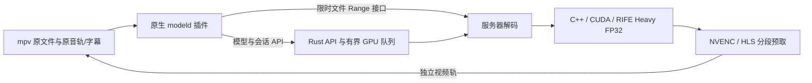

# modeld

在 mpv 中使用远程 GPU 插帧。API 与调度层使用 Rust，推理和视频处理使用 C++/CUDA，播放器通过原生 C 插件接入。服务与插帧插件无需 Python 或 VapourSynth；网站视频复用 mpv 已配置的解析器，例如 yt-dlp。

本期只提供 **RIFE 4.26 Heavy FP32**：TensorRT-RTX 1.7.1.116，禁用 TF32，CUDA Graph 双流执行，GPU 预处理与 NV12 输出，NVENC 编码回传。模型注册与有界任务队列为后续超分、LLM 后端预留扩展位置，当前不宣称支持这些任务。

## 播放方式

打开原视频后按 **Ctrl+Shift+i**，插件添加并选择远程 60 fps 视频轨。再次按键恢复原视频。音轨、字幕、章节和主时间轴继续使用原文件。新文件默认关闭插帧，日式 2D 动漫保持原视频即可。



本地文件只通过不可猜测的临时 URL 共享给服务端，接口绑定 NetBird 地址，不提供目录浏览。关闭插帧或离开文件会取消会话；异常退出由服务端 TTL 回收。

B 站等网站视频使用 mpv 已解析的实际媒体地址。插件从 `stream-open-filename` 的 DASH/EDL 时间轴中选取当前视频节目，并传递播放器使用的 Referer、User-Agent 等 HTTP 请求头，音轨与弹幕字幕继续由原播放器管理。不会把网页地址当作视频，也不会再次调用解析器。需要同时更新客户端与服务端到 0.1.2 或更新版本。

已使用实际 B 站 1080p/30 fps DASH 视频验证：外部视频轨为 HEVC 60 fps，原 AAC 与 ASS 保留，约 30 秒播放时钟测试掉帧为 0、最大音画差约 32 ms，并完成暂停状态下前后拖动。[测试数据](docs/validation-20261117-bilibili.json) 使用无显示输出，不代表所有站点或网络条件。

## Gentoo 安装

ebuild 位于 [gentoo-cs](https://github.com/csbxd/gentoo-cs)：

```sh
# NVIDIA 服务端：含 SDK、模型权重、专用账号和服务定义
emerge --ask app-misc/modeld::gentoo-cs

# 播放端：无需 NVIDIA GPU 或 CUDA
emerge --ask media-plugins/mpv-modeld::gentoo-cs
```

服务端在 `/etc/modeld/server.json` 设置 NetBird 监听地址和 `public_url`，再启用 `modeld.service` 或 OpenRC 的 `modeld`。首次启动编译并缓存原生分辨率引擎，预热完成后 `/health` 返回 ready。

服务端 API token 在安装时单独生成，位于 `/etc/modeld/api.token`。管理员应将凭据安全配置到客户端私有文件；不要放入仓库。

客户端配置示例：

```json
{
  "api": "http://s8030.netbird.cloud:8765",
  "token_file": "/home/YOUR_USER/.config/modeld/api.token",
  "callback_address": "auto"
}
```

保存为 `~/.config/modeld/client.json`，token 文件权限设为 0600。把安装的 `/usr/lib64/mpv/scripts/modeld.so` 链接到 `~/.config/mpv/scripts/modeld.so`，重新打开 mpv。

`modelctl health` 与 `modelctl models` 可检查连接。`modelctl source FILE` 为 API 调试临时共享指定文件，结束命令即停止共享。插件会通过系统 NSS 解析 NetBird HTTP 媒体地址，兼容使用 c-ares 的 mpv/libcurl 与系统 split DNS 的差异。

## API

| 接口 | 用途 |
|---|---|
| `GET /health` | 就绪状态 |
| `GET /v1/models` | 已实现模型及任务能力 |
| `POST /v1/sessions` | 创建插帧会话 |
| `GET /v1/sessions/{id}/index.m3u8` | VOD 视频播放列表 |
| `GET /v1/sessions/{id}/segments/{n}.ts` | 指定时间段视频，支持拖动定位 |
| `POST /v1/sessions/{id}/heartbeat` | 保活与暂停状态 |
| `DELETE /v1/sessions/{id}` | 取消会话及后续任务 |

控制接口使用 `Authorization: Bearer …`。播放列表和分段 URL 使用 128 位随机会话 capability，应同样视为私有凭据。创建请求示例：

```json
{
  "task": "frame_interpolation",
  "model": "rife-4.26-heavy-fp32",
  "source_url": "http://YOUR_NETBIRD_IP:PORT/source/PRIVATE_CAPABILITY",
  "source_headers": {},
  "target_fps": 60
}
```

`source_headers` 可选，旧客户端可以省略。用于媒体源的 Referer、User-Agent、Cookie、Origin、Authorization、Accept、Accept-Language、X-Forwarded-For；限制字段数、长度和换行，拒绝 Host、Range 等协议控制字段。这些请求头仅用于取源，不添加到返回的视频 URL 中。

服务端提供固定上限的会话数、GPU 队列、分辨率引擎缓存与视频分段缓存。仅提前生成一个后续分段以覆盖网络传输延迟；暂停后停止新增计算，取消会话会中断源读取和剩余帧生成。默认最多 2 个会话、8 个排队任务、每会话缓存 12 个 2 秒分段、120 秒空闲回收。

播放器端通过本地代理使用 4 条持续 HTTP 连接，并行接收视频并按序推进预取。缓冲不足时联动暂停音视频，补足后恢复；暂停状态下拖动也可请求新位置的预览帧。分辨率引擎缓存达到上限时回收未被会话使用的实例。

HLS 解复用和 HEVC 解码还需要后续分段才能释放已有帧，因此缓冲判断保留 6 秒余量，补足到 8 秒后恢复。弱网络下会增加等待时间，以保持原音轨与远端画面的同步。

2026-11-17 在目标机器上验证：原生 1080p、HEVC 60 fps 外部视频轨和原 AAC 音轨连续播放 40 秒，8 次采样没有暂停或掉帧，最大音画时间差约 29.7 ms；暂停时前后定位也已验证。此项使用无显示输出验证播放时钟，[原始数据](docs/validation-20261117.json) 不代表所有片源和网络条件的保证。

0.1.1 还使用 asa 的完整 mpv 配置连接正式 systemd 服务，验证弱网下自动暂停和恢复：40 次采样，掉帧为 0，最大音画时间差约 48 ms；[缓冲测试数据](docs/validation-20261117-buffering.json) 同样使用无显示输出。该次测试需要明显的预缓冲，带宽不足时不能保证连续实时播放。

## 画质与范围

支持原生偶数尺寸、最大 1920×1080、低于 60 fps 的可定位 SDR 视频，输出时间轴固定为 60 fps。网站视频需由 mpv 成功解析为单段 HTTP 媒体或 DASH 分离音视频中的完整视频文件；多片段拼接、HDR、直播、DRM 和 4K 推理不在本期范围。服务端不解析网页。文件打开、解码或服务故障会保留或恢复原视频轨。

推理为 FP32；传输使用 **8 位 HEVC NVENC、QP 18**，属于有损编码。可在服务端配置 `encoder` 为 `h264_nvenc`，或调整 `encoder_qp`。网络码率、编码和客户端解码都会影响实际播放，60 fps 视频格式不等于已验证的端到端实时吞吐。

权重来自 [vs-mlrt external models](https://github.com/AmusementClub/vs-mlrt/releases/tag/external-models) 的 `rife_v2/rife_v4.26_heavy.onnx`，SHA-256：

```text
990ceae958e3da49a112125fa2ba3d1bcc361e97012e609492e37f33527d7955
```

上游 [Practical-RIFE](https://github.com/hzwer/Practical-RIFE) 使用 MIT 许可。TensorRT-RTX 采用 NVIDIA 自身许可，SDK 和模型权重由独立 ebuild 获取，不包含在本仓库源码包内。

## 开发与测试

```sh
# 播放端及文件 Range / capability 协议测试
cmake -S . -B build-client -G Ninja -DMODELD_SERVER=OFF
cmake --build build-client
ctest --test-dir build-client --output-on-failure

# 无 GPU 的 Rust 协议、时间轴、参数测试
cargo test --locked --no-default-features
cargo clippy --locked --no-default-features --all-targets -- -D warnings

# 服务端原生库与 Rust 二进制（RTX SDK 安装在 /opt/tensorrt-rtx）
cmake -S . -B build-server -G Ninja -DMODELD_CLIENT=OFF \
  -DMODELD_SERVER=ON -DCMAKE_CUDA_ARCHITECTURES=89
cmake --build build-server
MODELD_NATIVE_LIB_DIR="$PWD/build-server" cargo build --locked --release
```

默认 CUDA 架构面向 RTX 4080 SUPER 的 SM 89。其他 GPU 需使用对应的 CUDA 架构重新构建。API 单元测试不使用伪造推理作为生产回退；实际推理、编码、网络与 mpv 播放需要在目标机器上单独验证。
