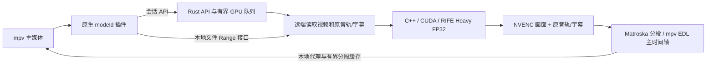

# modeld

在 mpv 中使用远程 GPU 插帧。API 与调度层使用 Rust，推理和视频处理使用 C++/CUDA，播放器通过原生 C 插件接入。服务与插帧插件无需 Python 或 VapourSynth；网站视频复用 mpv 已配置的解析器，例如 yt-dlp。

本期只提供 **RIFE 4.26 Heavy FP32**：TensorRT-RTX 1.7.1.116，禁用 TF32，CUDA Graph 双流执行，GPU 预处理与 NV12 输出，NVENC 编码回传。模型注册与有界任务队列为后续超分、LLM 后端预留扩展位置，当前不宣称支持这些任务。

已在目标 RTX 4080 SUPER 上与普通 TensorRT 11.4.0.106 做同条件原生 C++ 对比：1080p 的完整 GPU 管线约为 57.45 对 46.09 张新帧/秒，测试样本的输出差异很小。测试包含上传、预处理和 NV12，解码、编码及网络另计。[对比结果与原始数据](benchmarks/tensorrt/results/2026-11-17/README.md)、[复现工具](benchmarks/tensorrt/README.md)。

## 播放方式

打开原视频后按 **Ctrl+Shift+i**，0.1.7 插件把主媒体切换为远端输出的 **60 fps 插帧画面 + 原音轨 + 内封字幕**。音频、字幕与附件直接复制，不做音频重编码。再次按键恢复原视频及当前位置；文件名、播放列表项目、标题、章节和外挂字幕保留。新文件默认关闭插帧，日式 2D 动漫保持原视频即可。需要两端同时升级到 0.1.7。



本地文件只通过不可猜测的临时 URL 共享给服务端，接口绑定 NetBird 地址，不提供目录浏览。关闭插帧或离开文件会取消会话；异常退出由服务端 TTL 回收。

插帧开启后，asa 不再保留原主媒体连接。网站的原视频与分离音轨由 s8030 读取并合并；本地文件仍由临时 Range 接口供 s8030 读取。外挂字幕继续使用已加载的字幕文件。

新主媒体使用 mpv 自带的 DASH/EDL 时间轴，画面、声音和内封字幕共用主解复用器及其原生缓存，无需修改 mpv。数据尚未生成时 HTTP 请求等待，mpv 原生 `paused-for-cache` 停住音视频时钟并在数据到达后恢复；插件不改写 `pause`，不再显示自定义“远端视频缓冲中”提示，也不再禁用 `demuxer-seekable-cache`。用户暂停期间仍能按 mpv 的缓存限制继续读取后续分段。

客户端另外保留默认 **256 MiB** 的已完成分段，按最近使用顺序回收。远距离拖动只取消过期的未完成请求；同一文件关闭后再次开启也复用已完成分段。`media_cache_bytes` 可调整为 1 字节至 2 GiB。缓存位于内存，离开文件或退出后释放；切换主媒体会重建 mpv 的原始文件缓存，已有原始画面不能直接当作插帧缓存使用。

0.1.6 支持原生 **1080×1920 竖屏**，与横屏共用最长边 1920、最短边 1080 的限制。尺寸校验、模型能力接口和推理引擎使用相同规则，不旋转或缩小输入。RGB 转换使用 FFmpeg 的对齐帧缓冲，再复制有效像素到 RIFE，避免宽度为 1080 时 SIMD 转换越过紧凑缓冲区边界。未知色彩空间的高清竖屏也按高清尺寸判断。

会话创建在后台执行，等待期间可再次按快捷键取消，也可直接切换视频；原视频继续播放，用户暂停状态保持原值。取消会关闭正在等待的连接，并清理已经创建但尚未接入的远端会话。服务端在请求取消时中断片源探测，探测线程真正退出前仍占用会话名额，避免重复请求堆积后台任务。

服务端 `source_timeout_seconds` 默认 30 秒，限制一次探测和一次分段生成的总耗时；探测单个地址最多使用 10 秒，为备用地址保留机会。即使远端持续少量传输或不断重连，也不能无限延长总时限。服务端超时返回 HTTP 504，日志记录阶段、耗时和状态；客户端区分源探测超时、连接中断与无法连接 API。客户端创建请求默认等待 45 秒，可用 `session_timeout_seconds` 调整；提高服务端上限时需相应调整客户端。

已在 RTX 4080 SUPER 上验证原生 1080×1920、30→60 fps：6 秒视频输出完整 360 帧 HEVC。慢速持续传输在设置的 3 秒总时限内返回 504；取消探测后约 0.19 秒可创建下一会话。实际 mpv 等待期间命令响应约 10 毫秒、取消约 21 毫秒，切换文件同样会取消等待。[验证数据](docs/validation-20261117-portrait-timeouts.json) 包含首次竖屏模型准备，不代表所有片源和网络条件。

B 站等网站视频使用 mpv 已解析的实际媒体地址。插件从 `stream-open-filename` 的 DASH/EDL 时间轴中选取当前视频节目，并传递播放器使用的 Referer、User-Agent 等 HTTP 请求头，同时从时间轴中选取当前音轨供服务端无损复制，外挂弹幕字幕由播放器恢复。不会把网页地址当作视频，也不会再次调用解析器。需要同时更新客户端与服务端到 0.1.2 或更新版本。

AV1 媒体源使用 FFmpeg 的 `libdav1d` 软件解码器，0.1.3 服务端 ebuild 强制启用 `ffmpeg[dav1d]`。仅有 FFmpeg 的原生 `av1` 或 `av1_cuvid` 解码器不足以供当前软件帧处理路径使用。H.264、HEVC 继续使用对应的软件解码器；无需改选其他源画质。

0.1.5 修复 B 站 MCDN 取源断线后损坏分段的问题。客户端向 B 站播放接口查询当前 DASH 文件的备用地址，按包含 cid、分 P 和编码编号的完整文件名匹配，优先使用官方提供的 UPOS HTTPS 地址；查询不到相同编码时继续使用原地址。它不重新选择分辨率或编码，也不修改 CDN 主机或签名。

服务端支持有限 HTTP 重连，遇到不完整数据包、解码或定位错误时重新打开取源连接与解码器，从分段起点重新生成视频，必要时切换备用地址。备用源须匹配原编码、尺寸、帧率和时长。失败分段允许再次生成；客户端对临时网络错误和 408/429/500/502/503/504 最多请求三次，仍失败时记录真实状态并在明确的播放失败后恢复原视频。

下列播放与恢复数据记录的是 0.1.1–0.1.6 的外部视频轨实现；0.1.7 已改为完整主媒体与原生缓存等待，主媒体切换、回退、跨分段字幕、已缓存定位与网络背压验证见 [0.1.7 验证数据](docs/validation-20261117-main-media.json)。

中途开启后显式对齐当前播放位置，直接请求对应的 HLS 分段。在实际 B 站 720p AV1 视频上验证了连续播放、跳至 6420.98 秒、退回 300 秒和 85.7 秒，以及关闭插帧后的选项恢复；采样掉帧为 0、最大采样音画差约 29.2 ms。[播放与定位测试数据](docs/validation-20261117-playback-recovery.json) 使用无显示输出，包含启动缓冲。

两端通过 Portage 安装 0.1.5 后，也使用 asa 的完整 mpv 配置及 Wayland Vulkan 实际窗口，在 6421 秒处开启并播放至 6433.55 秒，选中 HEVC 60 fps，保留原 AAC 和 ASS，采样掉帧为 0，并确认窗口画面正常显示。[实际窗口验证](docs/validation-20261117-gui-recovery.json) 包含初始定位与预缓冲时间。

使用真实 AV1 样本主动切断主源，并让后续主源请求返回 503，已验证切换备用源后重新生成完整 120 帧 HEVC 分段。[断线恢复测试数据](docs/validation-20261117-recovery.json) 包含首次加载分辨率引擎的时间，不代表稳态推理吞吐。

已用实际 720p/30 fps AV1 DASH 视频验证解码和插帧：播放推进超过 33 秒，保留原 AAC/ASS，输出 HEVC 60 fps，掉帧为 0，最大采样音画差约 34.3 ms。[AV1 测试数据](docs/validation-20261117-av1.json) 包含启动预缓冲，使用无显示输出。

已使用实际 B 站 1080p/30 fps DASH 视频验证：外部视频轨为 HEVC 60 fps，原 AAC 与 ASS 保留，约 30 秒播放时钟测试掉帧为 0、最大音画差约 32 ms，并完成暂停状态下前后拖动。[测试数据](docs/validation-20261117-bilibili.json) 使用无显示输出，不代表所有站点或网络条件。

## Gentoo 安装

ebuild 位于 [gentoo-cs](https://github.com/csbxd/gentoo-cs)：

```sh
# NVIDIA 服务端：含 SDK、模型权重、专用账号和服务定义
emerge --ask app-misc/modeld::gentoo-cs

# 播放端：无需 NVIDIA GPU 或 CUDA
emerge --ask media-plugins/mpv-modeld::gentoo-cs
```

服务端在 `/etc/modeld/server.json` 设置 NetBird 监听地址和 `public_url`，再启用 `modeld.service` 或 OpenRC 的 `modeld`。首次启动编译并缓存原生分辨率引擎，预热完成后 `/health` 返回 ready。

服务端 API token 在安装时单独生成，位于 `/etc/modeld/api.token`。管理员应将凭据安全配置到客户端私有文件；不要放入仓库。

客户端配置示例：

```json
{
  "api": "http://s8030.netbird.cloud:8765",
  "api_address": "",
  "token_file": "/home/YOUR_USER/.config/modeld/api.token",
  "callback_address": "auto",
  "media_cache_bytes": 268435456
}
```

保存为 `~/.config/modeld/client.json`，token 文件权限设为 0600。把安装的 `/usr/lib64/mpv/scripts/modeld.so` 链接到 `~/.config/mpv/scripts/modeld.so`，重新打开 mpv。

若 NetBird 域名解析不稳定，可把 `api_address` 设置为该服务端已确认的 NetBird IP，例如 `100.123.9.240`。它仅指定此 API 主机的连接地址，同时适用于返回的 HLS 地址；HTTP Host、HTTPS 的 SNI 和证书主机校验继续使用 `api` 中的域名，不修改系统 DNS。留空则使用正常解析。

`modelctl health` 与 `modelctl models` 可检查连接。`modelctl source FILE` 为 API 调试临时共享指定文件，结束命令即停止共享。插件会通过系统 NSS 解析 NetBird HTTP 媒体地址，兼容使用 c-ares 的 mpv/libcurl 与系统 split DNS 的差异。

0.1.4 客户端默认记录结构化日志，GUI 启动 mpv 也能保留报错：

```sh
modelctl logs        # 最近 100 行
modelctl logs 300    # 最近 300 行
modelctl log-path    # 显示完整路径
```

默认路径为 `~/.local/state/modeld/mpv.log`，设置 `XDG_STATE_HOME` 时跟随该目录。文件权限 0600，超过 2 MiB 轮换为 `mpv.log.1`。日志包含客户端版本、PID、选中轨道、EDL 时间轴结构、API 状态和耗时、分段时间轴、主媒体切换、缓存复用与 mpv 警告；错误标注发生阶段。URL 仅保留主机，隐藏路径、查询参数、认证头及 Cookie 值。

## API

| 接口 | 用途 |
|---|---|
| `GET /health` | 就绪状态 |
| `GET /v1/models` | 已实现模型及任务能力 |
| `POST /v1/sessions` | 创建插帧会话 |
| `GET /v1/sessions/{id}/index.m3u8` | 有限分段清单；main 模式由客户端转换为 mpv EDL |
| `GET /v1/sessions/{id}/init.mkv` | main 模式音视频与字幕的初始化头 |
| `GET /v1/sessions/{id}/segments/{n}.ts` | 兼容旧客户端的纯视频分段 |
| `GET /v1/sessions/{id}/segments/{n}.mkv` | main 模式的插帧画面、原音轨和内封字幕分段 |
| `POST /v1/sessions/{id}/heartbeat` | 保活与暂停状态 |
| `DELETE /v1/sessions/{id}` | 取消会话及后续任务 |

控制接口使用 `Authorization: Bearer …`。播放列表和分段 URL 使用 128 位随机会话 capability，应同样视为私有凭据。创建请求示例：

```json
{
  "task": "frame_interpolation",
  "model": "rife-4.26-heavy-fp32",
  "source_url": "http://YOUR_NETBIRD_IP:PORT/source/PRIVATE_CAPABILITY",
  "source_backups": [],
  "source_headers": {},
  "target_fps": 60
}
```

`output_mode` 默认为 `video`，兼容旧客户端。0.1.7 插件请求 `main`，可选 `audio_source_url` 指定分离的 DASH 音轨，`include_audio` / `include_subtitles` 默认均为 true。返回的 `media.tracks` 列出原流索引与输出轨道 ID。main 模式使用 Matroska 初始化头和绝对时间戳的 Cluster；清单供 modeld 客户端构造 mpv EDL，不应当作通用 Matroska HLS 播放器接口。Matroska 不支持的源字幕编码会报错并回退原媒体。

`source_headers` 可选，旧客户端可以省略。用于媒体源的 Referer、User-Agent、Cookie、Origin、Authorization、Accept、Accept-Language、X-Forwarded-For；限制字段数、长度和换行，拒绝 Host、Range 等协议控制字段。这些请求头仅用于取源，不添加到返回的视频 URL 中。

`source_backups` 在 0.1.5 加入，最多八个 HTTP(S) 地址，必须指向同一份视频。旧客户端省略此字段仍可使用服务端重连和分段恢复。

服务端提供固定上限的会话数、GPU 队列、分辨率引擎缓存与视频分段缓存。仅额外提前生成一个后续分段以覆盖网络传输延迟；暂停后停止服务端自发预取，但继续完成播放器的显式分段读取，包括填充前向缓存与暂停时定位。取消会话会中断源读取和剩余帧生成。默认最多 2 个会话、8 个排队任务、每会话缓存 12 个 2 秒分段、120 秒空闲回收。

播放器端通过本地代理使用 4 条持续 HTTP 连接，并行接收视频并按序推进预取。所有轨道共用 mpv 的主媒体缓存，数据不足时由 mpv 处理缓存等待；用户暂停时也可继续缓存和定位。分辨率引擎缓存达到上限时回收未被会话使用的实例。

前向与后向缓存大小、缓存等待阈值均使用用户的 mpv 配置。插件不再设置固定 6/8 秒阈值，不会为了缓冲切换用户的暂停开关。

2026-11-17 在目标机器上验证：原生 1080p、HEVC 60 fps 外部视频轨和原 AAC 音轨连续播放 40 秒，8 次采样没有暂停或掉帧，最大音画时间差约 29.7 ms；暂停时前后定位也已验证。此项使用无显示输出验证播放时钟，[原始数据](docs/validation-20261117.json) 不代表所有片源和网络条件的保证。

0.1.1 还使用 asa 的完整 mpv 配置连接正式 systemd 服务，验证弱网下自动暂停和恢复：40 次采样，掉帧为 0，最大音画时间差约 48 ms；[缓冲测试数据](docs/validation-20261117-buffering.json) 同样使用无显示输出。该次测试需要明显的预缓冲，带宽不足时不能保证连续实时播放。

## 画质与范围

支持原生偶数尺寸、最长边不超过 1920 且最短边不超过 1080（横屏 1920×1080 或竖屏 1080×1920）、低于 60 fps 的可定位 SDR 视频，输出时间轴固定为 60 fps。网站视频需由 mpv 成功解析为单段 HTTP 媒体或 DASH 分离音视频中的完整媒体文件；多片段拼接、HDR、直播、DRM 和 4K 推理不在本期范围。服务端不解析网页。文件打开、解码或服务故障会保留或恢复原视频轨。

推理为 FP32；传输使用 **8 位 HEVC NVENC、QP 18**，属于有损编码。可在服务端配置 `encoder` 为 `h264_nvenc`，或调整 `encoder_qp`。网络码率、编码和客户端解码都会影响实际播放，60 fps 视频格式不等于已验证的端到端实时吞吐。

权重来自 [vs-mlrt external models](https://github.com/AmusementClub/vs-mlrt/releases/tag/external-models) 的 `rife_v2/rife_v4.26_heavy.onnx`，SHA-256：

```text
990ceae958e3da49a112125fa2ba3d1bcc361e97012e609492e37f33527d7955
```

上游 [Practical-RIFE](https://github.com/hzwer/Practical-RIFE) 使用 MIT 许可。TensorRT-RTX 采用 NVIDIA 自身许可，SDK 和模型权重由独立 ebuild 获取，不包含在本仓库源码包内。

## 开发与测试

```sh
# 播放端及文件 Range / capability 协议测试
cmake -S . -B build-client -G Ninja -DMODELD_SERVER=OFF
cmake --build build-client
ctest --test-dir build-client --output-on-failure

# 无 GPU 的 Rust 协议、时间轴、参数测试
cargo test --locked --no-default-features
cargo clippy --locked --no-default-features --all-targets -- -D warnings

# 服务端原生库与 Rust 二进制（RTX SDK 安装在 /opt/tensorrt-rtx）
cmake -S . -B build-server -G Ninja -DMODELD_CLIENT=OFF \
  -DMODELD_SERVER=ON -DCMAKE_CUDA_ARCHITECTURES=89
cmake --build build-server
MODELD_NATIVE_LIB_DIR="$PWD/build-server" cargo build --locked --release
```

默认 CUDA 架构面向 RTX 4080 SUPER 的 SM 89。其他 GPU 需使用对应的 CUDA 架构重新构建。API 单元测试不使用伪造推理作为生产回退；实际推理、编码、网络与 mpv 播放需要在目标机器上单独验证。

服务端启用 `BUILD_TESTING` 后还构建手工故障测试源 `modeld-fault-source VIDEO PORT`，仅监听 127.0.0.1。以 `/primary` 和 `/backup` 创建会话，随后 `POST /fail` 会切断主连接并使后续主源请求返回 503。通过实际模型请求分段并检查 `/stats`、服务日志及输出帧数，可以验证断线、备用源切换和完整分段重建；此工具不安装到系统。

该测试源的 `/drip` 每 100 毫秒发送一个字节，用于验证总时限不会被持续少量数据重置。启动 `max_sessions=1`、`source_timeout_seconds=3` 的独立原生测试 API 后，可运行 `node tests/probe-deadlines.mjs API TOKEN_FILE SOURCE_FIXTURE REPORT.json` 验证 504、HTTP 取消和名额释放。`modeld-source-probe URL TIMEOUT_SECONDS [CANCEL_AFTER_MS]` 可单独检查原生取源、解码与 RGB 转换，不初始化推理引擎。这些工具只用于开发测试，Node.js 不属于服务或播放器的运行依赖。

`node tests/main-media.mjs MODELDSO SOURCE.mkv SEGMENT_DIR REPORT.json` 使用真实渲染后的 12 秒夹具（320×180 H.264/FLAC/ASS 源文件；`init.mkv`、`0.mkv` 至 `5.mkv` 插帧 Cluster）进行播放器回归。它主动阻塞后续分段，检查原生缓存等待与音频时钟停住、用户暂停值不变、数据到达恢复、暂停时继续前向缓存、六次缓存定位、字幕跨分段、主媒体恢复和开关后的分段复用。测试的 HTTP 服务只提供已渲染数据，实际 GPU 输出需另行验证。
